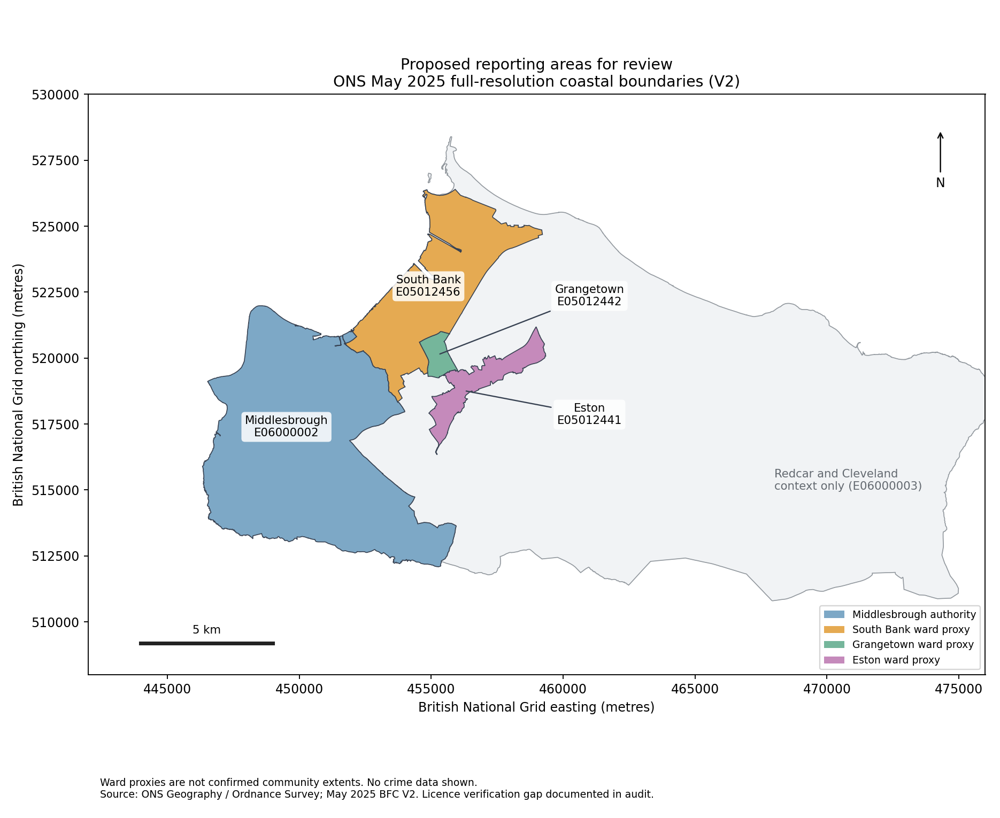

# Limited feasibility pilot

Executed 13 October 2026 (Africa/Lagos). This supplements the [source audit](source-geography-feasibility-audit.md) and [methodology](proposed-methodology.md). This is a file/geography feasibility check, not a crime analysis. No area crime totals, rates, trends, dashboard or research findings were calculated. The PR remains for review and must not be merged automatically.

## Retained evidence and scope

Raw inputs are outside Git at `/workspace/crime-pilot/raw/`; response metadata and run logs are in `/workspace/crime-pilot/evidence/`. The committed [evidence manifest](pilot-evidence.json) contains exact request/download URLs, UTC retrieval or file-save timestamps, SHA-256 hashes, archive-member CRCs, schemas and checks, without individual crime records or raw polygons. File-save timestamps for supplemental boundary probes are distinguished from recorded HTTP retrieval timestamps. These local raw files must be preserved separately from the Git repository; they are not restored by cloning the PR.

The official export form generated a Cleveland-only, August 2026 street-crime ZIP from `https://data.police.uk/data/` with `date_from=2026-08`, `date_to=2026-08`, `forces=cleveland`, `include_crime=on`; outcomes and stop-and-search were not selected. Its generated download is:

`https://policeuk-data.s3.amazonaws.com/download/bc1198b715202d1e647cd36724a7a5845fe153cd.zip`

The source job and exact request selections are in the manifest. The job/download URL may be temporary; reproduce the form submission rather than assume indefinite URL availability. The ZIP is 398,649 bytes and contains only `2026-08/2026-08-cleveland-street.csv`. ZIP/member integrity passed. All rows report August 2026 and Cleveland Police in both force fields. The file has 8,592 rows; this is a file validation count, **not a Middlesbrough or community crime finding**. No missing coordinates or LSOA codes were found in this sample; missing Crime IDs are present and must not trigger blanket row deletion.

Historical sampling used verified HTTPS byte ranges on official archive URLs, retaining each response range and the complete decompressed selected CSV. Requests require status 206, the exact `Content-Range`, and a stable ETag using `If-Match`, and abort if a server tries to send a complete archive. The script caps range transfers at 8 MiB per sampled snapshot. `zipfile` checks each extracted member's CRC. **No complete historical ZIP was downloaded; whole-archive MD5 verification has not occurred.** A range sample establishes member-level feasibility, not full archive integrity or month completeness. Full acquisition must verify publisher checksums before use of complete archives.

## Smallest advertised archive cover

The archive-list parser inspected 153 snapshot entries. No listed snapshot covers more than 36 requested months, and the requested period contains 140 months, so at least four are needed. An earliest-uncovered-month/furthest-end interval selection finds the following four-snapshot cover, meeting that lower bound. This is minimum **snapshot count**, not a proven minimum-byte download plan; different four-snapshot covers can exist.

| Official snapshot URL | Advertised contained months | Use for canonical street months | Listed download size | Pilot inspection |
| --- | --- | --- | --- | --- |
| https://data.police.uk/data/archive/2017-12.zip | January 2015–December 2017 | January 2015–December 2017 | 1.4 GB | January 2015 and December 2017 Cleveland members |
| https://data.police.uk/data/archive/2020-12.zip | January 2018–December 2020 | January 2018–December 2020 | 1.6 GB | Not downloaded or member-inspected |
| https://data.police.uk/data/archive/2023-12.zip | January 2021–December 2023 | January 2021–August 2023 | 1.6 GB | January 2021 and December 2023 Cleveland members |
| https://data.police.uk/data/archive/2026-08.zip | September 2023–August 2026 | September 2023–August 2026 | 1.6 GB | December 2023 and August 2026 Cleveland members |

Estimated full transfer: **6.2 GB using the publisher's rounded size labels**; this is not an exact byte budget or an unpacked-space estimate. Actual HEAD lengths for the three sampled archives are 1,536,527,524, 1,706,935,130 and 1,733,535,664 bytes respectively. The 2020 archive byte length remains unmeasured. Pilot range transfers per run were 906,445, 976,977 and 1,101,323 bytes respectively, plus the 398,649-byte custom export. Rechecks add traffic; these figures describe the representative successful runs, not total session bandwidth.

The only overlap in this chosen cover is September–December 2023. Use the August 2026 snapshot for those months under a documented “newest selected snapshot wins” rule. Keep both raw versions and hashes, but place only one chosen `(product, force, month)` version in the canonical dataset. Do not join or sum copies by row position, coordinates or missing Crime IDs. Full acquisition should first verify a member inventory for all 140 Cleveland street months; advertised ranges are not proof of their presence.

These snapshot blocks have different acquisition/publication vintages. Publisher warnings that older snapshots are out of date still apply. This minimal-cover rule does not promise the newest possible historical revision. Obtaining the latest retained revision for every old month could require more snapshots or publisher guidance and is a different acquisition objective. Report vintage discontinuities at block joins and check adjacent months before permitting trends.

The listing's MD5 strings for all four selected snapshots are recorded unchanged in the manifest and pass format validation. An unrelated June 2019 entry has a nonstandard `...-100` suffix; the first plan check exposed that condition. The corrected planner retains and flags that unselected entry rather than changing its digest or rejecting valid selected archives. No verification was disabled.

## Representative compatibility and revision checks

| Street month | Snapshot / source | File rows, for validation only | Schema and categories |
| --- | --- | ---: | --- |
| January 2015 | December 2017 archive | 6,552 | 12 columns; 14 observed category labels |
| December 2017 | December 2017 archive | 7,614 | Same |
| January 2021 | December 2023 archive | 6,676 | Same |
| December 2023 | December 2023 and August 2026 archives | 6,523 in each | Same schema and category inventory, different contents |
| August 2026 | August 2026 archive and current custom export | 8,592 in each | Same; the two decompressed CSVs are byte-identical |

Observed columns: `Crime ID`, `Month`, `Reported by`, `Falls within`, `Longitude`, `Latitude`, `Location`, `LSOA code`, `LSOA name`, `Crime type`, `Last outcome category`, `Context`.

Observed labels in all samples: Anti-social behaviour; Bicycle theft; Burglary; Criminal damage and arson; Drugs; Other crime; Other theft; Possession of weapons; Public order; Robbery; Shoplifting; Theft from the person; Vehicle crime; Violence and sexual offences. Preserve these original labels; ASB remains its own series. All inspected force fields identify Cleveland Police and all member months match their names.

The December 2023 versions have different SHA-256 hashes. Among matching nonempty Crime IDs, `Last outcome category` changes were observed. Equal row counts and category labels therefore do not imply identical or immutable data. This probe is not a complete revision census and does not establish universal Crime ID uniqueness. Crime totals must not be inflated by separate outcomes or revised copies.

**Confirmed:** a shared parser is feasible for these samples. **Unresolved:** all-month schema/category continuity, recording-definition changes, force publication gaps, duplicate-ID semantics and spatial completeness. Identical headers also do not establish a stable LSOA vintage; current source notes specify 2021 LSOAs, while archive files need vintage checks. Assign points to explicit polygons instead of treating legacy LSOA names as interchangeable boundaries. Successful downloading is never the comparability gate.

## Official boundaries and review map

Retrieved from ONS Geography-owned items through their published ArcGIS FeatureServer services. Both May 2025 products are V2 full-resolution boundaries clipped to the coastline at Mean High Water (BFC). Queries request EPSG:27700; exact expanded URLs, hashes and feature selections are in the manifest.

| Area | Code | Proposed fixed geography | Official service / item |
| --- | --- | --- | --- |
| Middlesbrough | E06000002 | May 2025 authority, BFC V2 | `LAD_MAY_2025_UK_BFC_V2/FeatureServer/0`, item `857b2b0e728742f382f5594834cfa0df` |
| South Bank | E05012456 | May 2025 ward proxy, BFC V2 | `WD_MAY_2025_UK_BFC_V2/FeatureServer/0`, item `e9e47eb4e5644c8bb725380b2ea89aa1` |
| Grangetown | E05012442 | Same | Same ward service |
| Eston | E05012441 | Same | Same ward service |
| Redcar and Cleveland, context only | E06000003 | May 2025 authority, BFC V2 | Same authority service |

Service prefix: `https://services1.arcgis.com/ESMARspQHYMw9BZ9/arcgis/rest/services/`. Official item pages: [wards](https://geoportal.statistics.gov.uk/datasets/e9e47eb4e5644c8bb725380b2ea89aa1) and [authorities](https://geoportal.statistics.gov.uk/datasets/857b2b0e728742f382f5594834cfa0df). Feature queries are restricted by **authority and codes**, avoiding the Cardiff ward also called Grangetown. All five polygons are valid. The four reporting polygons have zero positive-area pairwise overlaps; all three wards lie inside the context authority. Shared edges still need the ambiguity rule proposed in the methodology.



This map contains no crime data. Redcar and Cleveland is background context, not an additional area to sum. The long South Bank ward extent illustrates why community-name equivalence needs local review; the ward proxy is not an agreed settlement boundary.

**Licence record:** both ONS asset descriptions state “Contains both Ordnance Survey and ONS Intellectual Property Rights” and link to `https://www.ons.gov.uk/methodology/geography/licences`. That exact licence page, with and without trailing slash, returned HTTP 403. The asset's full geographic terms and required OS attribution therefore remain **unverified**; do not infer them from the police licence or general Nomis permissions. The review map attributes ONS/OS and explicitly flags the licence gap. Resolve exact geographic reuse conditions before public research publication.

Supplemental official December 2015 BFC wards have codes E05001522 (South Bank), E05001509 (Grangetown) and E05001508 (Eston), and their polygons differ from May 2025. The largest observed extent difference is South Bank. These snapshots confirm change but do not establish its legal effective date, every intermediate change or January 2015 extent. Do not splice historical wards into a fixed-boundary series. Supplemental December 2022 BFC polygons use the current three codes, but are not geometrically identical to May 2025; the manifest records that mismatch. Such differences may include geometry/coastline maintenance and must not automatically be labelled electoral changes.

## Population candidates and rate gate

Nomis API metadata and small population queries succeeded even though the main ONS landing and geography-licence pages returned 403. Raw population responses are retained; no population rates were calculated.

| Official table | Available reference years in retrieved time metadata | Pilot / compatibility |
| --- | --- | --- |
| `NM_2002_1`, local-authority population by single year of age | 1991–2025 | Retrieved all-age, total-gender observations for Middlesbrough in 2015 and 2025. Returned geography is April 2023 authority geography; code E06000002 matches, but extent alignment to the chosen May 2025 polygon still needs verification. Metadata describes census-rebased estimates replacing earlier editions. |
| `NM_2014_1`, small-area estimates, 2021 based | 2011–2024 | Retrieved all-age, total-gender observations for each proposed ward code in 2015 and 2024. Response geography is **2022 wards**. Codes match the proposed proxies, but December 2022 and May 2025 polygons differ; code equality is not exact alignment. Earlier estimates on later geography are a backseries, not populations of the historical 2015 wards. |
| `NM_2010_1`, small-area estimates, 2011 based | 2011–2020 | Metadata retrieved only. Do not splice this into the 2021-based series without rebasing/geography checks. |

Metadata endpoints follow `https://www.nomisweb.co.uk/api/v01/dataset/{table}/def.sdmx.json` and `.../time.def.sdmx.json`. Exact successful CSV requests and parameters are in the manifest: geography codes, date selection, `gender=0`, `c_age=200` (All Ages), `measures=20100`. Observations have “Normal Value” status; that is not a precision or comparability guarantee. Incorrect `date.def.sdmx.json` probes returned no usable codelist; the successful time metadata uses `time.def.sdmx.json`.

The retrieved Nomis copyright page (`https://www.nomisweb.co.uk/home/copyright.asp`) permits reuse of ONS material under the OGL subject to its conditions, requests “Source: Office for National Statistics”, and distinguishes third-party material. This supports the population tables' ONS licence record, not automatic clearance of OS geographic products.

**Rates remain unresolved.** No 2026 denominator is advertised in either relevant table. Do not carry forward 2025 authority or 2024 ward populations without an approved estimation policy. For earlier ward rates, a defensible option is to adopt the official 2022 ward polygons as the fixed numerator geography matching the supplied estimates, subject to source methodology and community review, rather than claim that May 2025 polygons are identical. Alternatively resolve the differences and justify a compatible aggregation. Count-based feasibility can continue while those decisions remain pending.

## Reproduce the limited checks

From `/workspace/teesside-historical-crime-analysis`, with Python 3.12 and TLS verification intact:

```bash
python scripts/feasibility_pilot.py archive-plan
python scripts/feasibility_pilot.py current
python scripts/feasibility_pilot.py archive-sample 2017-12 2015-01 2017-12
python scripts/feasibility_pilot.py archive-sample 2023-12 2021-01 2023-12
python scripts/feasibility_pilot.py archive-sample 2026-08 2023-12 2026-08
python scripts/feasibility_pilot.py population
python -m venv --system-site-packages /workspace/crime-pilot/venv
/workspace/crime-pilot/venv/bin/python -m pip install shapely==2.1.2 matplotlib==3.10.8
/workspace/crime-pilot/venv/bin/python scripts/pilot_boundaries.py --map docs/maps/proposed-areas-2025.png
```

These commands were executed successfully. Matching retained raw inputs are reused; differing content fails rather than silently overwrites. To preserve a newly revised publisher file, choose a new external `--root`. The map script sets writable plotting caches; its initial cache warnings were resolved. Raw-only directories must remain outside the checkout. Use the existing isolated checkout, not a new worktree. Map dependencies do not enable or authorise a dashboard or the full acquisition.

Required hosts used successfully include `data.police.uk`, `policeuk-data.s3.amazonaws.com`, `geoportal.statistics.gov.uk`, `services1.arcgis.com`, and `www.nomisweb.co.uk`. Initial S3/ArcGIS proxy blocks were resolved during the session after domain additions were saved; saving a draft alone is not proof of runtime access. ONS licence and Redcar council requests still returned HTTP 403. The optional Hub-download route failed; the publisher-documented FeatureServer route worked.

## Remaining decisions before full acquisition

Confirm community proxies and geographic licence conditions; decide fixed 2025 count boundaries versus a population-compatible 2022 ward definition; inspect all proposed member inventories, particularly the uninspected 2020 snapshot; validate missingness, categories and recording practice across the complete period; and approve the source-vintage policy. Check why and when historical ward extents changed. The pilot supports **technical count-data acquisition and parsing feasibility**, not an approved comparable research series or rate analysis. Full acquisition remains a later authorised milestone.
